# English Power Quest

**Level up your character. Level up yourself.**

一个简体中文 / English 双语像素风英语学习 RPG。玩家从枫叶镇出发，通过 NPC 剧情、英语答题战斗、技能成长和三阶段最终 Boss 完成冒险。

本说明面向**从 GitHub 下载 ZIP 或拿到项目文件夹的人**：先安装并启动项目，再按下方路线试玩。项目使用 **PHP + MySQL / MariaDB + 原生 JavaScript / Canvas**，不是可以双击打开的离线 HTML 游戏。

## 游戏截图

### 01 · 登录与游客入口

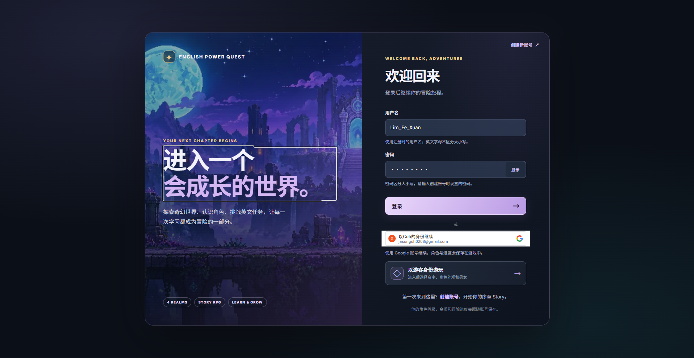

支持用户名密码、Google 账号或游客进入游戏，并继续对应角色的冒险进度。

<details>
<summary>展开完整游玩截图：剧情、战斗、商店、世界与怪物图鉴</summary>

### 02 · 冒险序章

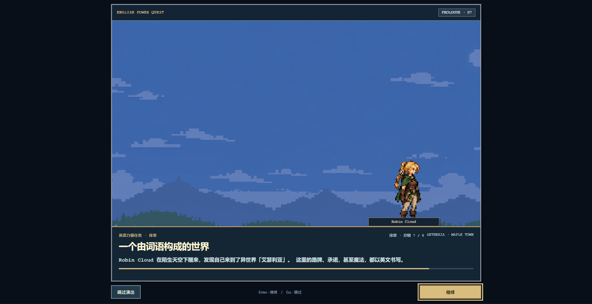

序章介绍由语言构成的异世界，引导玩家进入英语学习冒险。

### 03 · 主线剧情

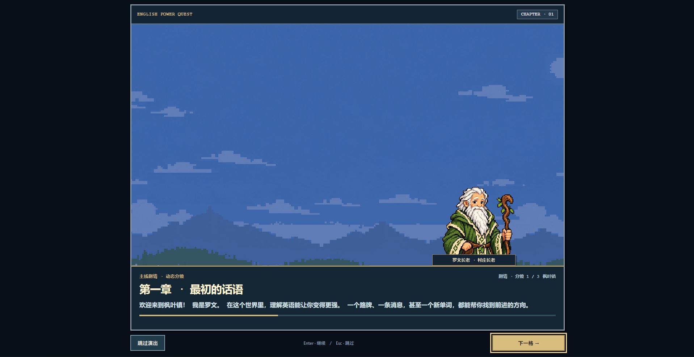

通过与罗文长老对话推进第一章，了解任务目标和世界背景。

### 04 · 英语答题战斗

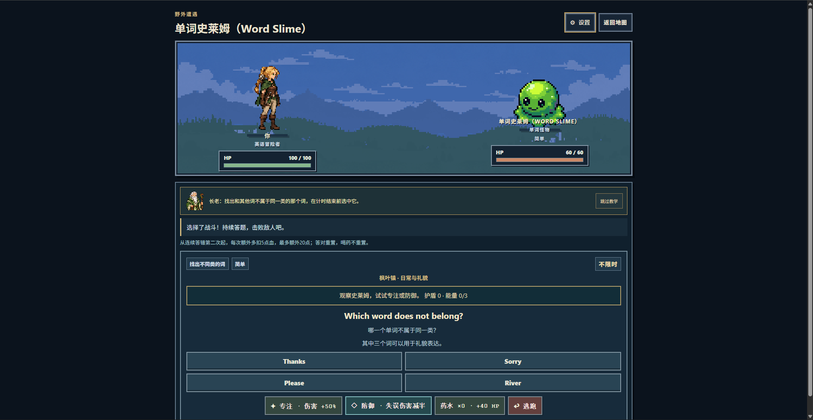

玩家通过英语题目攻击怪物，并可以选择专注、防御或使用库存药水。

### 05 · 村庄桥梁与商人

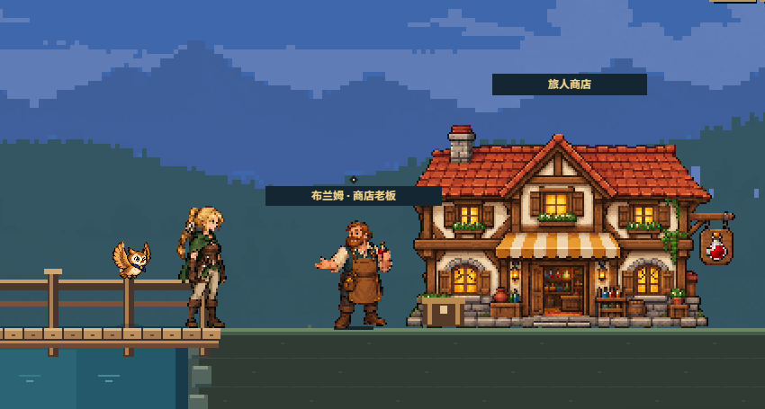

走过村庄右侧的桥后，可遇到商人布兰姆并进入旅人商店。

### 06 · 药水、粒子与随从商店

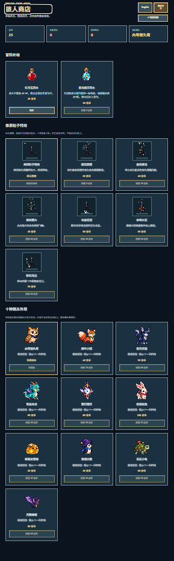

商店提供治疗与提示药水、粒子特效以及十种随从造型。

### 07 · 世界传送

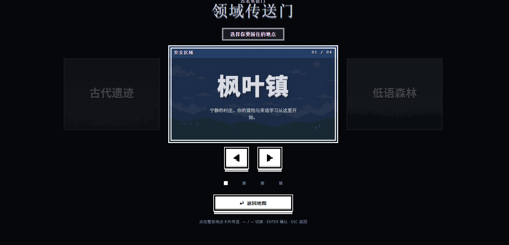

使用传送门切换四个世界，点击世界卡片即可前往选定地点。

### 08 · 旧营地与高塔

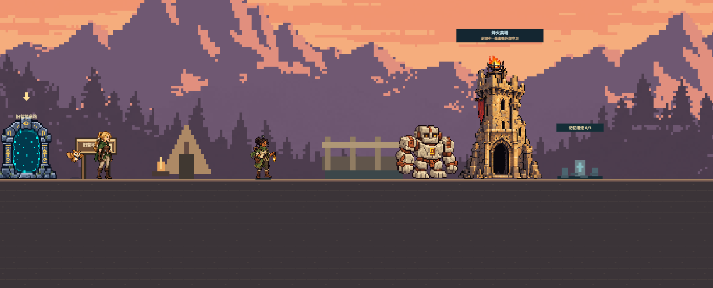

旧营地的高塔在击败外部守卫后解锁，玩家也可通过记忆碑复习错题。

### 09 · 古代遗迹守卫

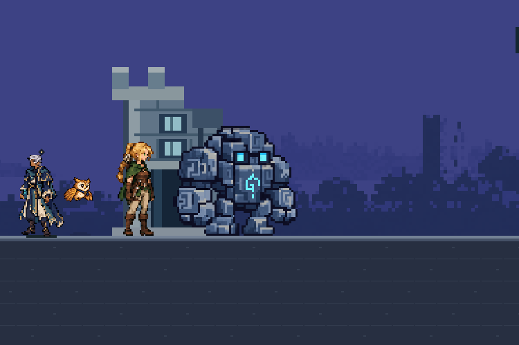

古代遗迹中有语法守卫等怪物，击败外部守卫后可进入对应内部挑战。

### 10 · 回声洞穴

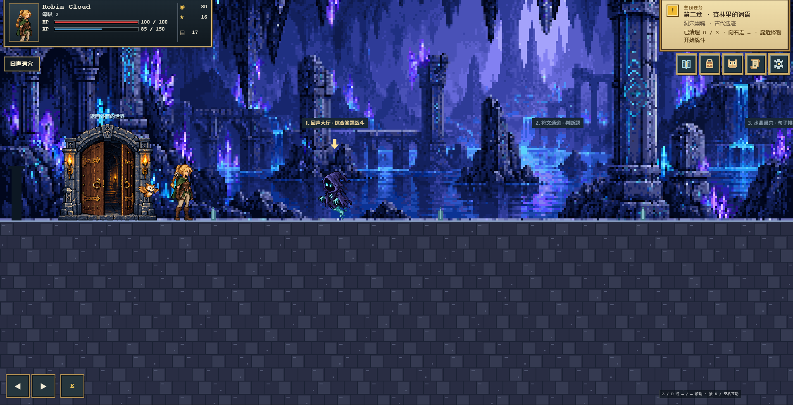

回声洞穴由连续房间组成，玩家依次挑战幽魂、水晶甲虫和回声飞龙。

### 11 · 枯树林与树妖

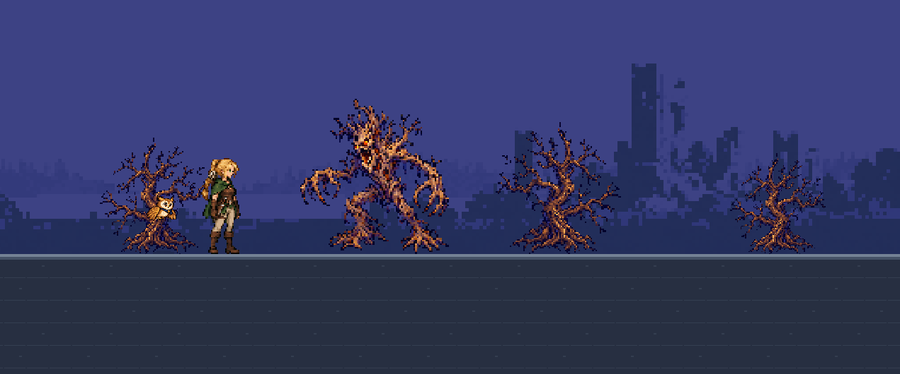

遗迹枯树林中的树妖守住前往城堡的道路，击败后会复原为樱花树。

### 12 · 怪物图鉴

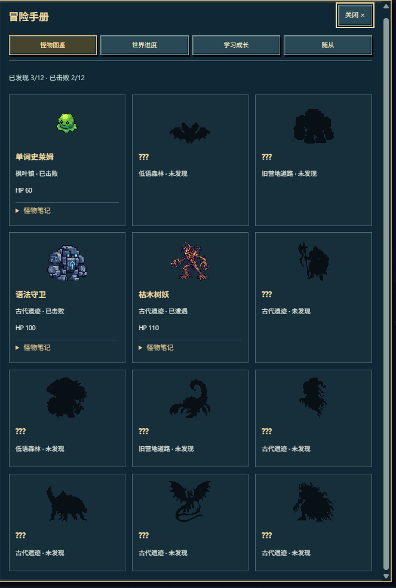

怪物图鉴记录已发现与已击败的怪物，尚未遇见的怪物以剪影显示。

</details>

## 1. 运行前需要准备什么

| 项目 | 说明 |
| --- | --- |
| XAMPP | 使用其中的 Apache、PHP 和 MySQL / MariaDB。现有本地验证环境为 PHP 8.2.12；不要使用 PHP 7。 |
| PHP 扩展 | 游戏需要 `mysqli`；Google 登录另需 `curl`、`openssl` 和有效的 CA 证书。 |
| 数据库 | 数据库集成测试覆盖 MySQL 8.0、MariaDB 10.4。 |
| 浏览器 | 支持 Canvas、JavaScript、Cookie 和 LocalStorage 的现代浏览器，例如 Chrome / Edge。 |
| 网络 | 本地普通账号和游客游玩由本机服务提供；Google 登录另需连接 Google 服务。 |

**正常安装游玩不需要 Node.js、npm、Composer 或前端打包，也不需要另外下载图片。** 保留项目内的 `assets/`、`images/`、`data/` 等目录。

如果电脑还没有 XAMPP，请先安装，并保留 Apache、MySQL、PHP 和 phpMyAdmin。以下步骤以安装在 `C:\xampp` 为例；若安装在其他位置，使用对应位置下的 `htdocs`。

## 2. 下载文件夹后，按这个顺序安装

### 第一步：放入 XAMPP 的网站目录

1. 在 GitHub 点击 **Code → Download ZIP**，解压文件；也可以使用拿到的完整项目文件夹。
2. 将包含 `index.php`、`login.php` 的那一层文件夹改名为 **`FYP`**。
3. 将它放到 XAMPP 的 `htdocs` 下。默认 Windows 路径如下：

```text
C:\xampp\htdocs\FYP\
├── index.php
├── login.php
├── register.php
├── battle.php
├── config\
├── database\
├── api\
├── includes\
├── js\
├── css\
├── data\
├── assets\
└── images\
```

确认实际存在 `C:\xampp\htdocs\FYP\index.php`。不要多套一层，变成 `FYP\English-Platform-Game-main\index.php`。

> 当前程序的资源、页面和 Cookie 路径使用 `/FYP/`。第一次安装请保留这个文件夹名。若要改成其他网址前缀，需要同步修改 PHP、JavaScript 和 CSS 中的路径，不能只改文件夹名称。

### 第二步：启动服务器

1. 打开 **XAMPP Control Panel**。
2. 点击 **Apache → Start**。
3. 点击 **MySQL → Start**。
4. 确认两项都处于运行状态，再进行数据库导入。

以下网址以 Apache 使用默认 HTTP 端口 **80** 为例。若你配置的是其他端口，例如 8080，访问地址应改为 `http://localhost:8080/FYP/login.php`，phpMyAdmin 也使用相同端口。

### 第三步：导入数据库（第一次安装）

以下步骤只适用于**没有旧玩家数据的新安装**。

1. 在浏览器打开 [phpMyAdmin](http://localhost/phpmyadmin/)，或点击 XAMPP 中 MySQL 旁的 **Admin**。
2. 在 phpMyAdmin 的服务器首页点击 **Import / 导入**。
3. 选择项目内的 [`database/english_power_quest_schema.sql`](database/english_power_quest_schema.sql)。
4. 执行导入，等待成功提示。
5. 左侧应出现 **`english_power_quest`** 数据库，里面有 `users`、`players`、`worlds` 等表。若没有马上显示，刷新左侧列表。

这个 SQL 文件会创建并选中 `english_power_quest`，建立表和基础世界数据。**只导入一次即可；新安装不需要再执行 migrations 001–007，也不需要导入 `demo_seed.sql`。**

`demo_seed.sql` 是开发测试资料，其中的 demo 用户没有可用于密码登录的密码。试玩时请自行注册或创建游客。

### 第四步：确认数据库连接

打开 [`config/db.php`](config/db.php)。默认配置对应常见的本机 XAMPP 设置：

```php
const EPQ_DB_HOST = '127.0.0.1';
const EPQ_DB_USER = 'root';
const EPQ_DB_PASS = '';
const EPQ_DB_NAME = 'english_power_quest';
```

- 如果你的 MySQL root 没有密码，保持 `EPQ_DB_PASS = ''`。
- 如果你设置过 MySQL 密码，将 `EPQ_DB_PASS` 改成你本机实际使用的密码。
- 如果使用另一个数据库用户，修改用户名和密码，并确保该用户可以访问这个数据库。
- 这些是**数据库连接资料**，不是游戏账号。游戏账号在网页中注册。

服务器也支持 `EPQ_DB_HOST`、`EPQ_DB_USER`、`EPQ_DB_PASS`、`EPQ_DB_NAME` 环境变量，优先于文件默认值。项目不会自动读取 `.env` 文件；使用环境变量时需要让 Apache 实际读取它们，并在修改后重启 Apache。对外部署请使用专用数据库用户，不要提交真实密码。

### 第五步：打开游戏

在浏览器进入：

**[http://localhost/FYP/login.php](http://localhost/FYP/login.php)**

选择一种开始方式：

- **创建账号**：注册后创建自己的角色，之后使用用户名和密码继续存档。
- **以游客身份游玩**：无需先注册，也会建立真实角色和数据库存档。
- **通过 Google 继续**：仅在完成下一节的可选配置后可用。

新玩家依次完成角色名字、性别和外观选择，观看序章，进入**枫叶镇 / Maple Town**的新手教学。男女各有三种不同造型：暗影旅人、森林游侠、星辰法师。

注册用户名为 **3–30 位**，允许英文字母、数字、点、横线和下划线，不能与已有用户名重复，大小写视为相同。新密码至少 **8 个字符**，包含至少一个大写英文字母和一个数字；英文与数字密码最多 72 位。邮箱可留空，填写时需要有效且未被其他账号使用。

**不要双击 PHP 文件、使用 `file:///` 地址或仅用 VS Code Live Server 打开。** 游戏需要 Apache 执行 PHP，并连接数据库。

### 安装成功后，先检查这五件事

- [ ] 登录页可以显示，图片和按钮正常。
- [ ] 能注册或创建游客，保存角色资料。
- [ ] 新角色从枫叶镇开始，能看到长老教学。
- [ ] 能移动、对话，完成第一场史莱姆答题战斗。
- [ ] 正常离开后重新进入，仍能继续同一名角色。

## 3. Google 登录配置（可选）

**不配置 Google 也能完整游玩。** `config/google.local.php` 被 Git 忽略，所以从 GitHub 下载的项目通常没有此机器的 Google Client ID；其他人的本地配置也不会自动同步过来。

启用方法：

1. 在自己的 Google Cloud 项目中创建 **Web application** 类型的 OAuth 客户端。
2. 为本地访问设置 Authorized JavaScript origin：默认端口使用 `http://localhost`。如果使用其他端口，添加对应的 `http://localhost:端口`。
3. 将 [`config/google.example.php`](config/google.example.php) 复制为同目录下的 `config/google.local.php`。
4. 将获得的公开 Client ID 填入新文件：

```php
<?php
return ['client_id' => '你的公开客户端ID.apps.googleusercontent.com'];
```

5. 刷新登录页，使用 Google 按钮测试。这里的占位内容需要替换成真正的完整 ID。

Origin **不包含 `/FYP/` 路径**；`localhost` 和 `127.0.0.1` 也属于不同来源，请统一使用你配置的来源。这个登录流程不需要 Client Secret。也可以使用服务器环境变量 `EPQ_GOOGLE_CLIENT_ID` 配置。

完整说明、账号绑定与错误排查见 [Google 登录与角色创建](docs/GOOGLE_SIGNIN_AND_CHARACTERS.md)。游客想保留当前角色时，请从游戏中的账号设置绑定或升级账号。

## 4. 操作方式

| 场景 | 操作 |
| --- | --- |
| 地图移动 | `A / D` 或 `← / →` |
| 与 NPC、传送门、建筑入口互动 | 走近后按 `E` 或空格，也可点屏幕上的互动按钮 |
| 对话继续 | 点击继续按钮，或使用 `Enter / Space` |
| 传送目的地 | 使用左右箭头切换，点击整张世界卡片选择；返回按钮取消 |
| 普通战斗 | 点击 FIGHT 开始答题，之后题目连续出现，无需每题重新选择 FIGHT |
| 判断 / 找不同 | 点击题目提供的选项 |
| 句子排列 | 按顺序选单词；可移除已选词或清空，完整排列后提交 |
| 最终 Boss 拼写 | 在输入框输入英文单词，按 Enter 或点击提交 |
| 菜单 | 点击图标；支持 Tab 切换焦点，多数弹层可用 Esc 返回 |
| 手机 / 触屏 | 使用屏幕左下角左右移动和 E 按钮，题目与菜单可直接触控 |

右上角像素图标依次对应**技能树、背包、随从带路、任务与洞穴、设置**。地图中的冒险手册包含怪物图鉴、世界完成度、学习报告和随从目标。

## 5. 从开局到通关的游玩过程

核心循环是：**看任务提示 → 找 NPC → 阅读剧情 → 答题战斗 → 获得 XP / 金币 → 解锁下一段挑战**。各世界传送门都在地图左侧；随从带路与任务提示会指向当前目标。

### 第一章：枫叶镇 / Maple Town

1. 完成角色创建和序章，学习左右移动。
2. 找**罗文长老 / Elder Rowan**，按照教学提示对话。
3. 挑战**单词史莱姆 / Word Slime**，学习题目、攻击和战斗菜单。
4. 返回长老完成教学，再按主线提示前往下一个世界。
5. 需要补给时向村庄右边走，**过桥后**可遇到商人**布兰姆 / Bram**和旅人商店。

枫叶镇是起点和补给村庄，没有需要挑战的村庄高塔。

### 第二至四章：世界推进

| 世界 | 主线 NPC | 外部守卫 | 外部胜利后可进入的可选挑战 |
| --- | --- | --- | --- |
| 低语森林 / Whispering Forest | 米拉 / Mira | 迷惑蝙蝠 / Confusion Bat | 苔光洞穴：苔菇守卫 |
| 旧营地道路 / Old Camp Road | 塔拉 / Tala | 道路守卫 / Road Guardian | 烽火高塔：余烬魔蝎 |
| 古代遗迹 / Ancient Ruins | 凯 / Kai | 语法守卫 / Grammar Guardian | 回声洞穴：洞穴幽魂 → 水晶甲虫 → 回声飞龙 |

按照 NPC 章节顺序推进。**先击败本世界外面的守卫，才可以进入对应洞穴或高塔。** 内部挑战提供额外战斗、奖励和完成度；不要求清空所有可选洞穴才能观看主线结局。

题库目前有 **240 道现行世界题目，每个世界 60 道**；加上兼容旧记录的内容共 259 道。题型包括判断、找不同和句子排列。难度按世界推进：枫叶镇简单，森林由简单过渡到中等，营地由中等过渡到困难，遗迹使用困难题。

### 最终章：城堡与三道封印

在古代遗迹击败外部语法守卫，并完成对应主线对话后，继续向右走。城堡在洞穴更右边，需要实际行走才能到达。

1. 击败**枯木树妖**：它会复原为比附近枯树更大的樱花树。
2. 继续向右，击败**城门侍卫**，获得城堡钥匙。
3. 走到城门旁互动，用钥匙开门；开门状态会保存。
4. 前往**终焉城堡**，挑战同一个最终 Boss **无言魔王**的三道封印：

   **理解词义 → 排列句子 → 英文拼写**

5. 正确作答推动破封，答错或超时会让怪物逼近。失败可查看答案和解释，再挑战一次。
6. 完成最终挑战并观看结局后，返回枫叶镇，可看到庆典装饰和 NPC 的通关后对话。

### 通关后还能做什么

- 补完可选洞穴 / 高塔和怪物图鉴。
- 查看各世界完成度，完成目标后领取一次性世界徽记奖励。
- 查看学习报告、错题和记忆复习，逐步修复记忆碑。
- 收集随从造型、随从饰品目标及粒子特效。
- 重新练习城堡挑战；首次结局奖励不会因为重复观看而再次发放。

当前版本已移除探索小支线，保留主线、可选战斗、记忆复习和收集目标。

## 6. 战斗、技能与补给规则

### 答题与怪物机制

- **答对攻击怪物，不会扣玩家生命。** 答错或超时触发怪物攻击。
- 连续答错时，从第二次起每次额外增加 **5 点伤害**，连错额外伤害最高 **20 点**；答对会重置连错次数。不是所有错误都固定只扣 5 HP，实际伤害还受怪物和防御影响。
- 普通世界战斗不倒计时，可慢慢阅读；可选内部战斗有计时挑战。
- 不同怪物有攻击预警、俯冲、藤蔓或护盾等机制。注意意图提示，再选择专注或防御；防御可以降低一次失误伤害。
- 打开战斗设置可暂停题目计时；恢复后继续同一道题。
- 战斗菜单中的技能用于选择专注、防御或已解锁的能力，道具使用背包库存；逃跑返回地图，不算击败守卫，也不会解锁洞穴。
- 战斗结束后可查看正确答案、自己的错误与双语解释，错题进入学习记录。

### 技能树

升级获得技能点，三个分支共用点数，按顺序解锁。每个分支的第 1 / 2 / 3 级分别需要角色等级 **2 / 3 / 5**，本次升级分别花费 **1 / 2 / 3** 点。

| 分支 | 作用 |
| --- | --- |
| 词汇 | 答对词汇题时增加伤害：+4 / +8 / +12。 |
| 语法 | 答对语法题时获得护盾：+2 / +4 / +6，上限 12 点护盾。 |
| 句子 | 答对句子题积累能量，积满后可释放重击，为下一次正确攻击增加 +6 / +12 / +18 伤害。 |

高等级替换同分支低等级效果，不把三档数值相加。解锁后从**下一场新战斗**生效，技能不会替你回答题目。界面会显示缺少的前置技能、等级或点数。

### 商店、背包和随从

| 商品 | 价格 | 用途 |
| --- | --- | --- |
| 红宝石药水 | 25 金币 | 战斗中使用已购库存，恢复最多 40 HP，不超过生命上限。 |
| 星光提示药水 | 30 金币 | 提供题目线索，仍需自己作答。 |
| 随从造型 | 免费向导猫头鹰；其他造型按商店标价 | 共 10 种造型，包含走路、跳动或飞行动作，可陪伴和指路。 |
| 粒子特效 | 30–70 金币 | 6 种可购买特效，在背包切换，仅改变外观。 |

**药水只能到商店购买，战斗中只能使用已拥有的库存。** 金币不足时显示差额；先完成战斗或世界目标获得金币，再回来购买。右上角背包用于查看和装备已有物品，不提供战斗中直接购物。

### 学习记录

冒险手册和学习日志会记录真实作答结果，区分普通战斗、重复作答、记忆复习和城堡挑战。样本不足时不会显示虚构的成长比较。记忆复习会隔一段时间以不同语境重现错过的知识；复习不扣 HP，也不要求倒计时作答。

## 7. 存档、游客与交接

- 账号、角色、金币、技能、背包和主要进度保存在 **MySQL**；浏览器还有按角色区分的缓存和未确认保存重试。
- 游客也有数据库存档，通过同一浏览器的 **30 天恢复 Cookie**继续。不要清除 Cookie，也不要依赖无痕窗口长期保留游客。
- 打算换电脑或长期保存时，请在当前游客内升级为账号或绑定 Google，保留同一个角色与进度。继续访问原服务器上的同一个数据库，账号才能找回原存档。
- **只复制项目文件夹不会复制玩家存档。** 全新导入结构文件得到的是新游戏环境；转移已有玩家需要另外导出、恢复数据库备份。
- 本项目需要服务器和数据库运行，不提供完整离线模式。遇到保存重试提示，请恢复连接并等待保存完成。

### 已有数据库时如何更新

先在 phpMyAdmin **导出备份**，再核对旧库结构，只执行尚未应用的迁移：

| 文件 | 作用 |
| --- | --- |
| [001](database/migrations/001_question_codes_and_difficulty_fk.sql) | 旧版题目编号与难度关联 |
| [002](database/migrations/002_auth_story_progress.sql) | 序章完成状态 |
| [003](database/migrations/003_persistent_guests.sql) | 持久游客与地图存档 |
| [004](database/migrations/004_four_worlds.sql) | 四个世界资料 |
| [005](database/migrations/005_verified_battles.sql) | 服务器判题、战斗与作答记录 |
| [006](database/migrations/006_character_profiles.sql) | 角色创建与外观资料 |
| [007](database/migrations/007_verified_quests.sql) | 主线、城堡挑战与防重复奖励记录 |

**不要向已有玩家的数据库重新导入完整 schema 或 demo seed。** 更新项目文件或执行 `git pull` 不会自动更新数据库。详细方法见 [游客与数据库说明](docs/GUEST_ACCOUNTS_AND_DATABASE.md)。

## 8. 常见问题

| 问题 | 检查方法 |
| --- | --- |
| 网页打不开 | 确认 Apache 正在运行，网址和端口与 XAMPP 配置一致。Apache 无法启动时先查看 XAMPP 日志与端口占用。 |
| 404 / 图片缺失 / 页面跳错位置 | 确认实际路径是 `htdocs/FYP/login.php`，没有多嵌套文件夹，浏览器地址含 `/FYP/`。 |
| PHP 显示成文字或打开后下载文件 | 当前服务器没有执行 PHP。改用 XAMPP Apache 的 `http://localhost/FYP/` 地址访问。 |
| MySQL connection failed / Access denied | 确认 MySQL 已启动，再核对 `config/db.php` 的主机、用户名、密码和库名。 |
| Unknown database / Table doesn't exist | 新安装检查完整结构文件是否成功导入；旧安装检查缺少的迁移，不要覆盖已有数据库。 |
| Duplicate table / 已存在的表 | 可能重复导入了完整结构文件。先确认已有数据和安装状态，不要直接删库。 |
| 注册或游客暂时无法创建 | 先核对数据库连接、表结构和 PHP `mysqli` 扩展，再查看 Apache / PHP 错误日志。 |
| Google 显示未启用 | 按第 3 节配置自己的 Client ID；不影响普通账号和游客游玩。 |
| Google 提示 origin_mismatch | 检查协议、主机、端口是否与配置来源一致，来源不能带 `/FYP/`。 |
| Google 验证连接失败 | 检查 PHP `curl`、`openssl` 扩展和有效的 CA 证书，以及 Google 网络连接；不要关闭证书验证。 |
| 新玩家出现在其他地图 | 先确认浏览器是否恢复了已有游客。测试全新角色可使用独立浏览器配置或新无痕窗口；保留旧游客的 Cookie。真正新建角色应从枫叶镇开始。 |
| 洞穴 / 高塔进不去 | 先击败对应世界外部守卫；按任务提示完成之前的剧情。 |
| 城堡门打不开 | 先打败遗迹外部守卫，再击败树妖和城门侍卫；取得钥匙后走到城门互动。 |
| 没声音 | 先点击页面或按键，再到设置开启声音并测试音效；浏览器可能阻止自动播放。 |
| 更新后仍看到旧界面 | 按 `Ctrl + F5` 强制刷新。不要为了刷新资源清除未升级游客的全部站点数据。 |

## 9. 项目结构与进一步阅读

```text
index.php / battle.php       地图与普通答题战斗
login.php / register.php    登录、注册和游客入口
character_setup.php         首次创建角色
account.php                 账号升级与 Google 绑定
shop.php / backpack.php     商店和已有物品
skills.php / learning.php   技能树和学习日志
api/                        服务器接口
includes/                   登录、判题、奖励、存档与成长规则
config/                     数据库和可选 Google 配置
database/                   首次安装结构、迁移与开发测试资料
data/                       题库、难度、世界、怪物、商品等内容
js/ / css/                  Canvas、交互与界面
assets/ / images/           像素素材
tests/ / tools/             开发检查和测试工具
docs/                       功能、更新与验证说明
```

- [新玩家完整流程试玩记录](docs/NEW_PLAYER_PLAYTEST_2026-10-18.md)：从全新游客到结局的实际浏览器检查、发现的问题与验证边界。
- [像素技能树、冒险手册与通关后内容](docs/PIXEL_HANDBOOK_AND_ENDGAME.md)。
- [技能效果与战斗节奏](docs/SKILLS_AND_COMBAT_PACING.md)。
- [世界题目与难度推进](docs/WORLD_QUESTION_PROGRESSION.md)。
- [随从、商店与角色造型](docs/COMPANIONS_SHOP_AND_HEROES.md)。
- [新手教学](docs/FIRST_ADVENTURE_TUTORIAL.md)。
- [Google 登录与角色创建](docs/GOOGLE_SIGNIN_AND_CHARACTERS.md)。
- [游客存档与数据库升级](docs/GUEST_ACCOUNTS_AND_DATABASE.md)。

部分旧文档记录历史实现，可能提到已移除的村庄高塔、探索支线或旧版三关纯拼写挑战。当前玩法以本 README、现有代码和最新功能说明为准。

## 10. 开发者验证（普通试玩者可跳过）

只有修改代码、运行开发测试时才需要 Node.js。以下 PowerShell 命令在项目根目录执行，PHP 路径以默认 Windows XAMPP 为例：

```powershell
# PHP 与主要 JavaScript 语法
Get-ChildItem -Recurse -Filter *.php | ForEach-Object { & C:\xampp\php\php.exe -l $_.FullName }
node --check js/rpg.js
node --check js/battle.js

# 不需要连接数据库的回归测试
$testFiles = (Get-ChildItem tests -Filter *.test.cjs).FullName
node --test $testFiles
& C:\xampp\php\php.exe tests/battle_rules_test.php
& C:\xampp\php\php.exe tests/combat_depth_test.php
& C:\xampp\php\php.exe tests/account_rules_test.php
& C:\xampp\php\php.exe tests/google_token_test.php
```

数据库集成检查见 [GitHub Actions 配置](.github/workflows/php-js-lint.yml)，只应在独立测试库执行，不能对现有玩家数据库运行测试初始化。语法、自动化回归、数据库集成、实际浏览器试玩是不同检查；通过其中一项不代表全部玩法和画面已经验证。真实 Google 账号授权与实体手机体验还需要在对应环境中确认。
